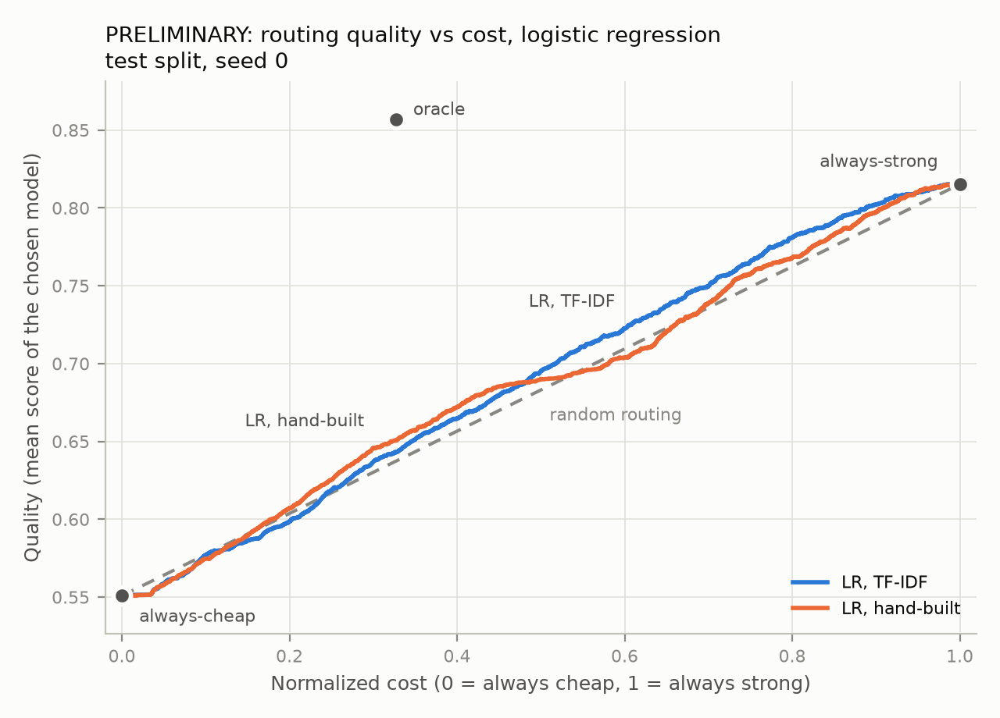

# EAS 510 Project 2: Interim Report

**Classical vs. Neural LLM Routers on RouterBench** 
Piyush Ranjan Shaw (50755499), Avimta Ajit Shahane (50745133) 
Repo: [github.com/shaw-piyush/EAS510-project2-pshaw-avimtaaj](https://github.com/shaw-piyush/EAS510-project2-pshaw-avimtaaj)

**Goal.** For each prompt, decide whether a cheap LLM (Mixtral-8x7B) is good enough or the prompt should go to a strong, expensive one (GPT-4). We compare a logistic regression baseline with kNN, k-means, gradient boosting (with a random forest check) and an MLP on RouterBench (0-shot), using TF-IDF, hand-built and sentence-embedding features. The embeddings are frozen (no fine-tuning), and no LLM is called. Routers are judged by the area under the quality-vs-cost curve and by the cost needed to reach 95% of GPT-4's quality.

## 1. Progress

**Data:** RouterBench is loaded from a pinned Hugging Face version and cleaned from 36,497 to 28,572 prompts in 9 benchmark groups. Subtasks whose scores aren't 0/1 (e.g. GSM8K, MT-Bench) are dropped, and duplicates are removed. Mixtral is correct on 55.2% of prompts.

**Evaluation framework:** quality-vs-cost routing curves (tied scores handled as blocks), AUC, lift over random routing, cost@95% (read off the test curve, and at a threshold chosen on validation), classifier metrics, and the reference policies (always-cheap, always-strong, random, oracle). Unit tests cover all of it.

**Features:** TF-IDF + SVD (256 dimensions), 13 hand-built text features, and frozen MiniLM-L6-v2 sentence embeddings computed for all 36,497 raw prompts. All three read the same flattened prompt text, with the last turn first, so that in two-turn prompts MiniLM's 256-token window is spent on the question rather than on a shared instruction.

**Experiment pipeline:** a 70/15/15 split stratified by benchmark, 5 seeds, preprocessing fit on train only, hyperparameters chosen on validation, test used once. A logistic regression baseline runs end to end, and plotting is in place.

## 2. Current results (PRELIMINARY: random split, test set, mean ± std over 5 seeds)

| Router | Test AUC | Lift over random | ROC AUC | Cost@95%, test curve (% of GPT-4) | Cost at validation threshold (% of GPT-4) |
|---|---|---|---|---|---|
| LR, TF-IDF | 0.6961 ± 0.0042 | 0.0135 ± 0.0036 | 0.7236 ± 0.0103 | 76.9 ± 1.4 | 76.6 ± 1.3 (target met in 2 of 5 seeds) |
| LR, hand-built | 0.6933 ± 0.0037 | 0.0107 ± 0.0044 | 0.6980 ± 0.0077 | 81.0 ± 1.9 | 79.6 ± 1.8 (target met in 1 of 5 seeds) |
| Random routing | 0.6826 ± 0.0041 | 0 | — | — | — |

Test AUC is the area under the quality-vs-cost curve. Cost@95% read off the test curve is the lowest cost at which the curve reaches 95% of GPT-4's quality; it is a best case, because it looks at the test data. The validation threshold is the honest version: the threshold chosen on validation, applied to test.

Always-cheap reaches quality 0.5486 at 5.3% of GPT-4's cost, and always-strong reaches 0.8167. The oracle, which sends a prompt to GPT-4 only when Mixtral is wrong and GPT-4 is right, reaches 0.8571 at 36.8%; it is an upper bound, not a router. The baseline beats random routing, but by a small margin: it needs about 77% of GPT-4's cost to reach 95% of its quality, where the oracle reaches higher quality at 37%.

*Figure 1. PRELIMINARY: quality vs normalized cost for both logistic regression routers on the test split of seed 0 (0 = always Mixtral, 1 = always GPT-4). The dashed line is random routing.*

## 3. Challenges

**Weak signal:** so far the lift over random is only about 0.01 AUC. The classifier ranks prompts better than chance (ROC AUC 0.70–0.72), but with a linear model this gives only a small routing gain. Differences between routers may be small, which is why every metric is reported over 5 seeds.

**Threshold transfer:** a threshold chosen on validation reached the 95% target on test in only 2 of 5 seeds (TF-IDF) and 1 of 5 seeds (hand-built).

**GSM8K dropped:** over 99% of GSM8K's scores are fractional rather than 0/1, so "the cheap model is correct" is undefined there. We dropped it along with five smaller non-0/1 subtasks (7,907 prompts in all, 7,450 of them GSM8K). This departs from our proposal, which planned separate GSM8K results; MBPP (423 prompts) is now the only free-form benchmark.

**Prompt length and formatting:** 6,115 of the 28,572 prompts (21%) are longer than MiniLM's 256-token window, including 42% of HellaSwag, so the embeddings see only their first 256 tokens while TF-IDF and the hand-built features read the full text. Multi-turn prompts often begin with a benchmark-wide instruction, so we put the last turn first. That only helps the 1,179 two-turn prompts (in bias detection, no question is truncated any more, against 111 with the original order). The question is still truncated in 5,987 prompts, 5,851 of them single-turn MMLU and HellaSwag prompts where turn order makes no difference.

**Data sharing:** RouterBench lists no license, so it is unclear whether we may redistribute part of it. We plan to bundle a small sample so that `main.py` can run offline in under 5 minutes. Please let us know if bundling a small sample is not acceptable.

**Uneven benchmarks:** MMLU and HellaSwag make up 84% of prompts, and some groups are tiny (accounting audit has 30), so per-benchmark results need care. Two groups (accounting audit, abstract2title) are too small or too one-sided to be held out on their own.

## 4. Plan for completion (final due Mon Dec 7)

**Nov 24–27:** kNN and k-means on embeddings (Piyush); gradient boosting (Nov 24), random forest check (Nov 25) and MLP (Nov 27) (Avimta). Then build the bundled sample for `main.py`.

**Nov 28–Dec 1:** full comparison across all feature sets, leave-one-benchmark-out generalization, per-benchmark error analysis, and a multi-model routing extension (choosing among more than two LLMs).

**Dec 2–7:** final tables and figures, `report.md`, a check that `main.py` runs in under 5 minutes offline, and submission.

<!--
Sources for every number (CLAUDE.md rule 5):
- Results table, reference policies, seeds-met counts: results/full/interim/summary.md,
  metrics_random.csv, reference_policies.csv
- 36,497 -> 28,572, 9 groups, 55.2%, 84%, accounting audit 30, MBPP 423, held-out eligibility:
  results/full/data_summary/cleaning_steps.csv and group_summary.csv
- GSM8K 7,450 rows and 99% fractional scores, 7,907 dropped: results/full/data_check/score_binary_by_eval.csv
- Truncation (6,115, 21%, 42% of HellaSwag, 1,179 two-turn, 111, 5,987, 5,851):
  results/full/truncation/truncation_by_benchmark.csv
- 36,497 embedded prompts: Avimta's full run of src/embed.py (data/cache/emb_ids.npy)
-->
